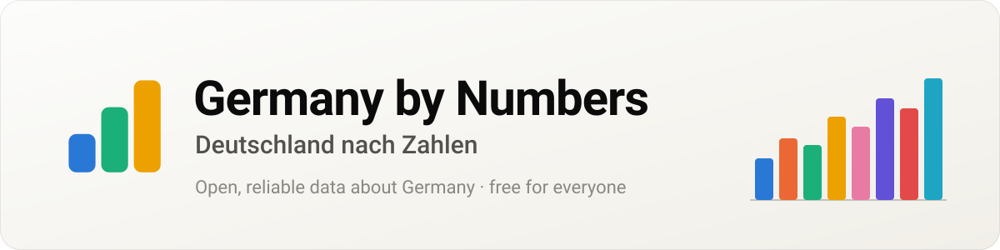
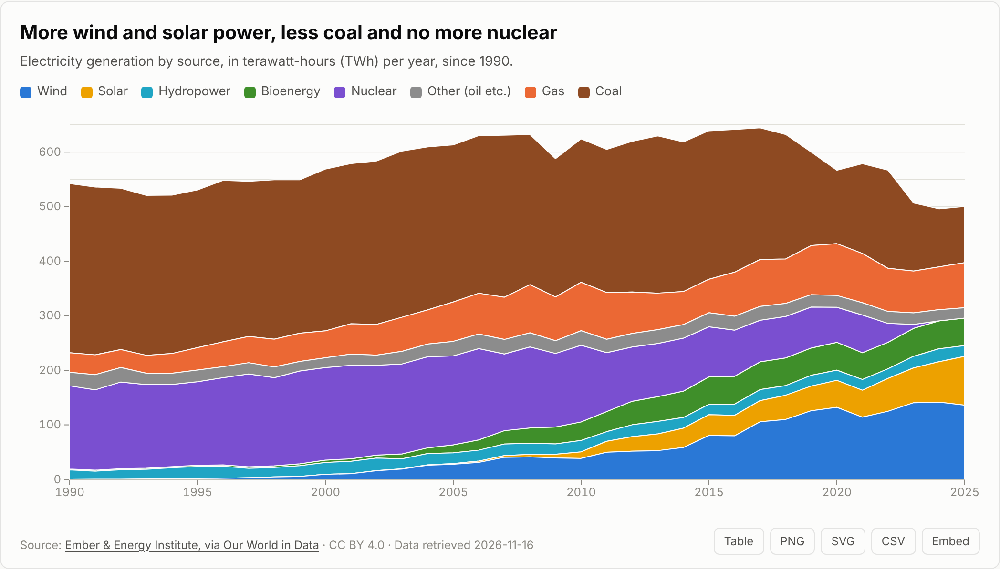
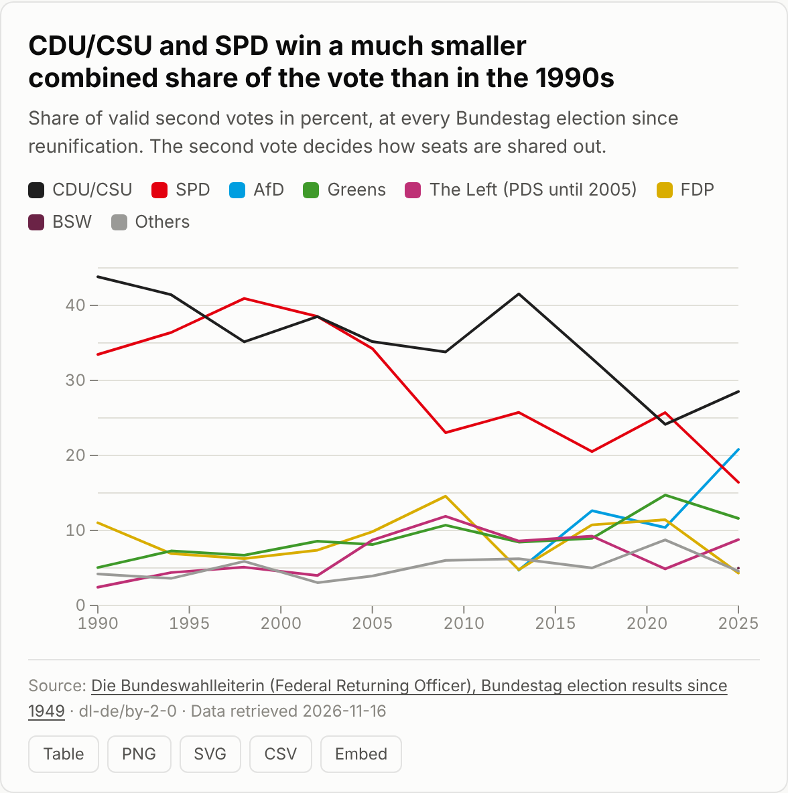
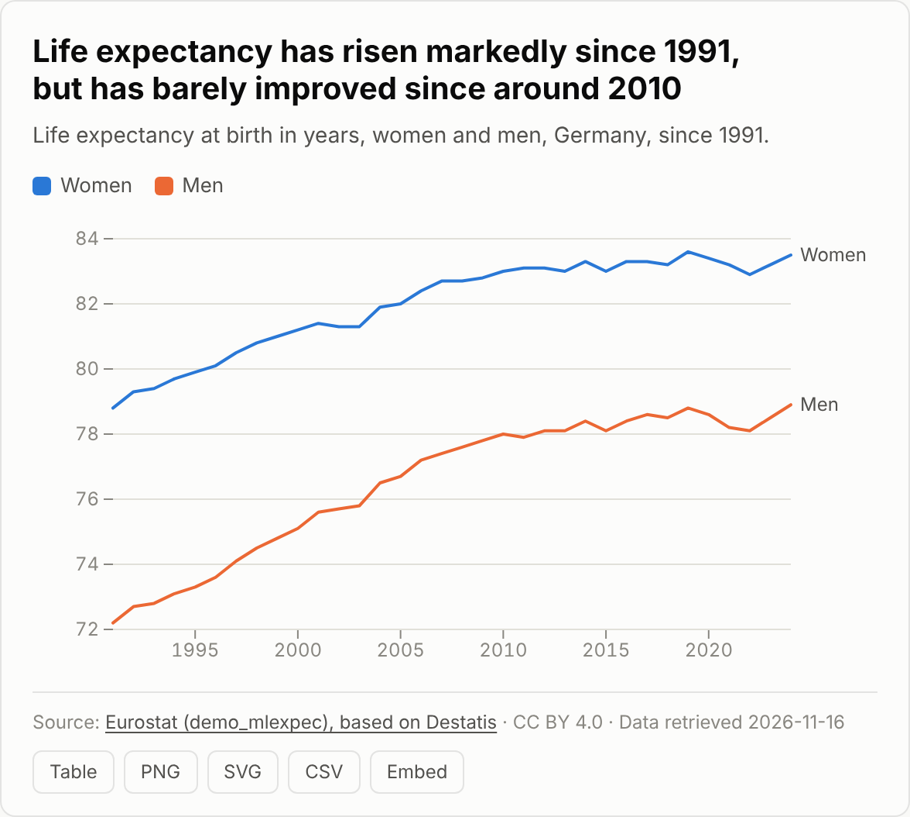

<p align="center">
  <a href="https://andreasadl-oss.github.io/germany-by-numbers/">
    
  </a>
</p>

<h3 align="center">
  👉 <a href="https://andreasadl-oss.github.io/germany-by-numbers/">andreasadl-oss.github.io/germany-by-numbers</a> 👈
</h3>

<p align="center">
  <a href="https://andreasadl-oss.github.io/germany-by-numbers/en/">🇬🇧 English</a> ·
  <a href="https://andreasadl-oss.github.io/germany-by-numbers/de/">🇩🇪 Deutsch</a>
</p>

<p align="center">
  <a href="https://andreasadl-oss.github.io/germany-by-numbers/"></a>
  <a href="https://github.com/andreasadl-oss/germany-by-numbers/actions/workflows/site.yml"></a>
  <a href="https://creativecommons.org/licenses/by/4.0/"></a>
  <a href="LICENSE"></a>
</p>

Open, reliable data about Germany, free for everyone. The charts cover the
economy, public finances, population, health, energy, climate, crime and
education, for Germany as a whole and for the 16 Länder. The site is in
German and English, and every number comes straight from an official source.

<p align="center">
  <a href="https://andreasadl-oss.github.io/germany-by-numbers/en/energy/">
    
  </a>
</p>

<table>
  <tr>
    <td width="50%"><a href="https://andreasadl-oss.github.io/germany-by-numbers/en/public-life/"></a></td>
    <td width="50%"><a href="https://andreasadl-oss.github.io/germany-by-numbers/en/society/"></a></td>
  </tr>
</table>

## 🗂️ What's inside

| | Topic | Charts |
|---|---|---|
| 💶 | [Economy, tax & spending](https://andreasadl-oss.github.io/germany-by-numbers/en/economy/) | GDP, inflation, unemployment, public revenue, spending and debt |
| 👪 | [People, health & society](https://andreasadl-oss.github.io/germany-by-numbers/en/society/) | Population, births and deaths, migration, life expectancy, causes of death, poverty risk, house prices |
| ⚡ | [Energy & climate](https://andreasadl-oss.github.io/germany-by-numbers/en/energy/) | Electricity mix, renewables, energy use, CO₂ and greenhouse gases |
| 🗳️ | [Elections, crime & education](https://andreasadl-oss.github.io/germany-by-numbers/en/public-life/) | Bundestag results and turnout, recorded crime, homicide, education |

Every chart can be shown as a table and downloaded as PNG, SVG or CSV, or
embedded in another page. Sources and licences:
[data sources](https://andreasadl-oss.github.io/germany-by-numbers/en/sources/).

## 🛠️ How it works

```
indicators/*.json   what to show: titles (DE/EN), chart type, source, how to fetch it
pipeline/fetch.py   downloads each indicator from its official source → data/<id>.csv
data/               tidy CSVs: year, geo (NUTS code), series, value  (+ _status.json)
site/build.mjs      generates the static site → dist/  (no framework)
site/assets/        chart rendering (Observable Plot), styles
test/               browser tests (Playwright + node:test)
docs/DATA_SOURCES.md  which source is used for what, licences, status, roadmap
```

To add a chart, add an entry to `indicators/<topic>.json`, then run the pipeline
and the build.

To mark a year on a chart, add a `notes` list to the indicator:

```json
"notes": [
  { "year": 2011, "kind": "break", "text": { "de": "…", "en": "…" } },
  { "year": 2020, "to_year": 2021, "kind": "event", "text": { "de": "…", "en": "…" } }
]
```

A `break` means the source changed its method or definition (a dashed line); an
`event` means something really happened (a solid line, or a shaded band with
`to_year`). Keep each text to one short line, and check it against the source's
own metadata. The build stops if a note lacks a language, has another kind, or
falls outside the indicator's data years. Notes work on charts with a year
axis (`line`, `area`, `bar-time`), not on `bar-latest`.

`line` and `bar-time` charts start their y-axis at zero, so a reader can judge
size at a glance. To zoom an indicator to its data range instead, add
`"baseline": "data"` (the default is `"zero"`). Use it only where the level is
near-constant and the change is the story, such as population. The build stops
on any other baseline value. Area charts
always start at zero and ignore the field. Stacked shares in % run to 100 only
when the series add up to about 100 % (a yearly total of at least 95 %);
otherwise the axis ends at the first tick above the largest total.

On a phone, a bar chart wraps long category names. A word too long for its
line breaks where its series label marks a soft hyphen (`\u00ad`), between the
parts of a compound: `"Behandlungs\u00adkomplikationen"`. Readers never see the
mark. A bar chart's test fails if a word breaks anywhere else, so add a mark
when a new long word needs one.

## 💻 Run locally

```bash
npm install
python3 pipeline/fetch.py        # or: python3 pipeline/fetch.py <indicator-id>
npm run build
npm run serve                    # http://localhost:8080
```

Python needs only the standard library.

## ✅ Tests

```bash
npx playwright install chromium   # once; cloud sessions already have a browser
npm test
```

`npm test` builds the site into a temporary folder, serves it and opens pages
in headless Chromium at a phone width (390 px) and a desktop width (1280 px).
Tests check only what a reader sees: page text, chart labels and element boxes.
They live in `test/`; `test/harness.mjs` has the helpers (`buildSite`, `serve`,
`open`), and `test/fixtures/` holds small indicator definitions and data for
cases the real data can't show. To build from other locations yourself:
`node site/build.mjs --indicators <dir> --data <dir> --out <dir>`.

If Playwright's own Chromium isn't installed, the tests fall back to a shared one
at `$PLAYWRIGHT_BROWSERS_PATH/chromium` (as in cloud sessions), which may be built
for a slightly older Playwright version.

## 🚀 Publishing

`.github/workflows/site.yml` refreshes the data every Monday, commits any
changes and deploys `dist/` to GitHub Pages at
<https://andreasadl-oss.github.io/germany-by-numbers/>. You can also start it manually
from the Actions tab. To turn on GitHub Pages, go to repository **Settings → Pages →
Source: GitHub Actions**.

## 📜 Licence

- **Charts and text:** [CC BY 4.0](https://creativecommons.org/licenses/by/4.0/).
  Credit "Germany by Numbers" and the original source.
- **Code:** [MIT](LICENSE).
- **Data:** belongs to its publishers and stays under their licences (Eurostat
  and Our World in Data: CC BY 4.0; Destatis and the Bundeswahlleiterin:
  Datenlizenz Deutschland – Namensnennung 2.0; some OWID energy data comes from third parties such as the
  Energy Institute, with their own terms). Every chart names its source; see
  [docs/DATA_SOURCES.md](docs/DATA_SOURCES.md).

## 💛 Thanks

- **Hannah Ritchie**, whose *UK by Numbers* inspired this project. This is an
  independent project and is not affiliated with her.
- Built with help from **Claude** (Anthropic). The numbers are not generated by
  AI; the pipeline downloads them from the official sources.
